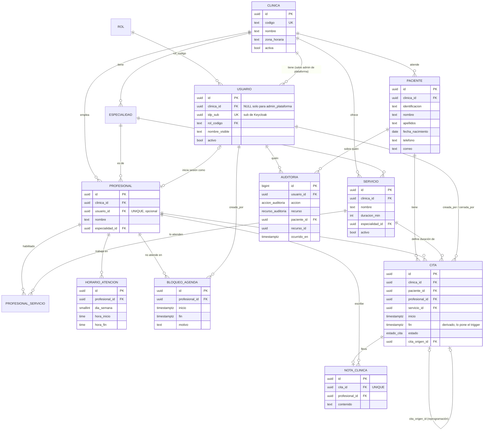

# Diseño del modelo de datos

Esquema completo en `db/init/01_esquema.sql`. Reglas del motor (triggers) en `02_reglas.sql`, permisos y RLS en `03_seguridad.sql`, índices en `04_indices.sql`.

## Diagrama entidad-relación

Toda tabla con datos de una clínica lleva `clinica_id`. Las llaves foráneas entre tablas de tenant son compuestas: `(clinica_id, profesional_id) REFERENCES profesional(clinica_id, id)`. Ver la sección de desnormalizaciones.

## Diccionario de datos

Convenciones: todas las llaves primarias son `uuid` generados por el motor (`gen_random_uuid()`), salvo `rol.codigo` (texto natural) y `auditoria.id` (secuencia, porque el orden de inserción importa). Los instantes son `timestamptz` (UTC en disco); las horas de horario son `time` en hora local de la clínica.

### rol
Catálogo global de los cuatro roles de la matriz. Coinciden con los roles de realm de Keycloak.

| Columna | Tipo | Nulo | Regla |
|---|---|---|---|
| codigo | text | no | PK: `admin_plataforma`, `admin_clinica`, `recepcion`, `profesional` |
| descripcion | text | no | |

### clinica (el tenant)
| Columna | Tipo | Nulo | Regla |
|---|---|---|---|
| id | uuid | no | PK |
| codigo | text | no | UNIQUE, `^[a-z0-9-]{3,40}$`; identificador legible (RF1) |
| nombre | text | no | no vacío |
| zona_horaria | text | no | nombre IANA, validado contra `pg_timezone_names` (trigger, MC011) |
| activa | boolean | no | por omisión true; si es false nadie de la clínica entra (403) |
| creada_en | timestamptz | no | now() |

### usuario
Solo el vínculo con el proveedor de identidad: las credenciales viven en Keycloak.

| Columna | Tipo | Nulo | Regla |
|---|---|---|---|
| id | uuid | no | PK |
| clinica_id | uuid | sí | FK clinica. CHECK: es NULL **si y solo si** el rol es `admin_plataforma` (RF2) |
| idp_sub | uuid | no | UNIQUE. El `sub` del token de Keycloak |
| rol_codigo | text | no | FK rol |
| nombre_visible | text | no | copia de nombre y apellidos de Keycloak para mostrar en bitácora y agenda |
| activo | boolean | no | baja lógica (RF2) |
| creado_en | timestamptz | no | |
| baja_en | timestamptz | sí | CHECK: si `activo` es false, tiene fecha |

### especialidad
| Columna | Tipo | Nulo | Regla |
|---|---|---|---|
| id | uuid | no | PK |
| clinica_id | uuid | no | FK clinica |
| nombre | text | no | UNIQUE por clínica |

### servicio (RF3)
| Columna | Tipo | Nulo | Regla |
|---|---|---|---|
| id | uuid | no | PK |
| clinica_id | uuid | no | FK clinica |
| nombre | text | no | UNIQUE por clínica |
| duracion_min | integer | no | 5 a 480, múltiplo de 5. Define el tamaño del espacio (I4). La API no deja cambiarla |
| especialidad_id | uuid | no | FK compuesta a especialidad de la misma clínica |
| activo | boolean | no | inactivo = sin disponibilidad ni reservas nuevas (MC009) |

### profesional (RF4)
| Columna | Tipo | Nulo | Regla |
|---|---|---|---|
| id | uuid | no | PK |
| clinica_id | uuid | no | FK clinica |
| usuario_id | uuid | sí | UNIQUE, FK compuesta a usuario de la misma clínica. Es lo que permite "solo los propios" y "solo citas propias" |
| nombre | text | no | |
| especialidad_id | uuid | no | FK compuesta |
| activo | boolean | no | |

### profesional_servicio (RF4)
Relación N:M: qué servicios atiende cada profesional. La API solo permite servicios de la misma especialidad del profesional.

| Columna | Tipo | Nulo | Regla |
|---|---|---|---|
| clinica_id | uuid | no | FK clinica (ver desnormalizaciones) |
| profesional_id | uuid | no | PK compuesta, FK compuesta |
| servicio_id | uuid | no | PK compuesta, FK compuesta |

### horario_atencion (RF5)
Un bloque por fila; varios por día (jornada partida).

| Columna | Tipo | Nulo | Regla |
|---|---|---|---|
| id | uuid | no | PK |
| clinica_id, profesional_id | uuid | no | FK compuesta |
| dia_semana | smallint | no | 1 (lunes) a 7 (domingo), ISO |
| hora_inicio, hora_fin | time | no | `hora_fin > hora_inicio`. Hora local de la clínica |
| | | | EXCLUDE: dos bloques del mismo profesional y día no se cruzan (409 `HORARIO_SOLAPADO`) |

### bloqueo_agenda (RF6)
| Columna | Tipo | Nulo | Regla |
|---|---|---|---|
| id | uuid | no | PK |
| clinica_id, profesional_id | uuid | no | FK compuesta |
| inicio, fin | timestamptz | no | `fin > inicio` |
| motivo | text | no | vacaciones, permiso, congreso |
| creado_por | uuid | no | FK compuesta a usuario |
| creado_en | timestamptz | no | |

### paciente (RF14)
No es usuario del sistema en esta etapa.

| Columna | Tipo | Nulo | Regla |
|---|---|---|---|
| id | uuid | no | PK |
| clinica_id | uuid | no | FK clinica |
| identificacion | text | no | UNIQUE por clínica. La misma persona en dos clínicas son dos pacientes distintos (aislamiento) |
| nombre, apellidos | text | no | |
| fecha_nacimiento | date | no | > 1900-01-01; la API además rechaza fechas futuras |
| telefono | text | sí | dato de contacto: leerlo o escribirlo se audita (RF18) |
| correo | text | sí | formato básico por CHECK; se audita igual |
| creado_en, actualizado_en | timestamptz | no | |

### cita (RF9 a RF13)
| Columna | Tipo | Nulo | Regla |
|---|---|---|---|
| id | uuid | no | PK |
| clinica_id | uuid | no | FK clinica |
| paciente_id, profesional_id, servicio_id | uuid | no | FK compuestas (misma clínica) |
| inicio | timestamptz | no | |
| fin | timestamptz | no | **derivado**: el trigger lo pone en `inicio + servicio.duracion_min` e ignora lo que mande la API (I4) |
| estado | estado_cita | no | `reservada` → `atendida` / `ausente` / `cancelada` / `reprogramada`. Los finales no salen (RF13, trigger) |
| motivo_cancelacion | text | sí | CHECK: presente si y solo si está cancelada (RF11) |
| cita_origen_id | uuid | sí | UNIQUE, FK a cita: la reprogramada de la que viene (RF10) |
| creada_por, cerrada_por | uuid | no / sí | FK compuestas a usuario. `cerrada_por` lo pone el trigger desde la sesión |
| creada_en, cerrada_en | timestamptz | no / sí | CHECK: `cerrada_en` es NULL si y solo si sigue reservada |
| | | | EXCLUDE `cita_sin_solape_profesional` (I1) y `cita_sin_solape_paciente` (I2), solo sobre `estado = 'reservada'` |

No se borra nunca (trigger): se cancela.

### nota_clinica (RF15)
| Columna | Tipo | Nulo | Regla |
|---|---|---|---|
| id | uuid | no | PK |
| clinica_id, cita_id | uuid | no | UNIQUE en cita_id: una nota por cita |
| profesional_id | uuid | no | el que atendió (ver desnormalizaciones) |
| contenido | text | no | no vacío. El dato más sensible del sistema |
| creada_en | timestamptz | no | la pone el trigger |

Trigger `nota_insertar`: solo sobre cita `atendida` y solo si el usuario de la sesión es el profesional de esa cita (MC005 → 403).

### auditoria (RF18)
Append-only: sin UPDATE, DELETE ni TRUNCATE para nadie (permisos + triggers, I6).

| Columna | Tipo | Nulo | Regla |
|---|---|---|---|
| id | bigint | no | identidad (orden de inserción) |
| clinica_id | uuid | no | FK clinica |
| usuario_id | uuid | no | lo sobrescribe el trigger con el usuario de la sesión: la aplicación no puede atribuir el acceso a otro |
| accion | accion_auditoria | no | `lectura`, `escritura` |
| recurso | recurso_auditoria | no | `nota_clinica`, `contacto_paciente` |
| paciente_id | uuid | no | sobre cuál paciente |
| recurso_id | uuid | sí | id de la nota, si aplica. Sin FK a propósito: la bitácora no depende de que el recurso siga existiendo |
| detalle | text | sí | qué campos se tocaron o qué ruta leyó |
| ocurrido_en | timestamptz | no | lo pone el trigger con `now()` |

## Normalización hasta 3FN

Partimos de lo que recepción anota en papel para una cita: "Lunes 16, 9:00, Ana Mora (1-1111-1111, 8888-0000) con la Dra. Ramírez, odontóloga, limpieza de 45 min, en Clínica Central (hora de Costa Rica). Atiende lunes 8-12 y 13-17."

**1FN: valores atómicos, sin grupos repetidos.**
- El horario "lunes 8-12 y 13-17" es un grupo repetido: cada bloque es una fila de `horario_atencion` (no un arreglo ni un texto "8-12,13-17"). Así la restricción de exclusión y el índice ven cada bloque.
- Los servicios que atiende un profesional son una lista: van a la tabla puente `profesional_servicio`.
- Nombre del paciente en `nombre` y `apellidos`; contacto en `telefono` y `correo` (uno de cada uno basta en esta etapa).

**2FN: ningún atributo depende de una parte de la llave.**
La única llave compuesta es `profesional_servicio (profesional_id, servicio_id)`. No tiene atributos propios, salvo `clinica_id`, que depende solo de `profesional_id`: es una dependencia parcial **deliberada** (ver abajo). Las demás tablas tienen llave simple, así que cumplen 2FN por construcción.

**3FN: ningún atributo no-llave depende de otro atributo no-llave.**
- En la cita de papel, "odontóloga" depende del profesional y "45 min" depende del servicio, no de la cita: van a `profesional.especialidad_id` y `servicio.duracion_min`.
- El nombre de la especialidad depende de la especialidad, no del servicio: tabla `especialidad`, referida por id.
- "Hora de Costa Rica" depende de la clínica: `clinica.zona_horaria`, no se repite en cita ni en horario.
- La descripción del rol depende del rol: tabla `rol`.
- El paciente aparece una vez en `paciente`; la cita solo guarda `paciente_id`.

## Desnormalizaciones deliberadas

| Dónde | Qué se repite | Por qué | Cómo se evita la anomalía |
|---|---|---|---|
| `clinica_id` en todas las tablas hijas (cita, profesional_servicio, horario, bloqueo, nota, auditoria) | La clínica ya se deduce del paciente o del profesional (dependencia transitiva; en `profesional_servicio`, parcial) | 1) RLS evalúa `clinica_id = app_clinica_actual()` sobre la fila misma, sin joins: más simple de auditar y más barato. 2) Las FK compuestas `(clinica_id, x_id)` hacen imposible que una fila apunte a un paciente o profesional de otra clínica, aunque alguien se salte la API. 3) Permite particionar por clínica en la Etapa 2 | Las FK compuestas obligan a que la copia coincida con el original: una cita con `clinica_id` distinto al de su paciente no se puede insertar |
| `cita.fin` | Se deduce de `inicio` + `servicio.duracion_min` | La restricción de exclusión (I1, I2) necesita el rango completo en la misma fila; no puede hacer un join al servicio | El trigger lo calcula siempre desde el servicio e ignora lo que venga en el INSERT; el UPDATE lo prohíbe (MC007). La API no permite cambiar la duración de un servicio |
| `nota_clinica.profesional_id` | Se deduce de `cita.profesional_id` | La política RLS `solo_propias` filtra notas por profesional sin join a cita | El trigger `nota_insertar` exige que coincida con el de la cita |
| `usuario.nombre_visible` | Copia de nombre y apellidos que viven en Keycloak | Mostrar quién hizo qué en bitácora y agenda sin llamar a Keycloak en cada lectura | Se escribe al crear el usuario por la API. Si alguien cambia el nombre en la consola de Keycloak, esta copia queda vieja: es solo para mostrar, ninguna regla depende de ella |

## Datos semilla

`scripts/generar_semilla.py` genera `db/init/05_semilla.sql` y `keycloak/medicitas-realm.json` con los mismos usuarios (mismo `sub`), de forma determinista (UUID v5). Contenido:

- 3 clínicas (Central Cartago, San Pedro, Bella Vista), con 3 especialidades y de 5 a 6 servicios cada una. Bella Vista está en `America/Panama` y las otras en `America/Costa_Rica`, para que las zonas horarias no se den por supuestas.
- Por clínica: 1 admin, 2 recepcionistas, 4 profesionales con usuario, horarios con jornada partida (algunos atienden sábado).
- 40 pacientes por clínica, con cédula, fecha de nacimiento, teléfono y correo.
- Citas desde 45 días atrás hasta 21 adelante del día en que se levanta la base, en todos los estados, con notas clínicas en buena parte de las atendidas. Las fechas son relativas para que siempre haya pasado y futuro.
